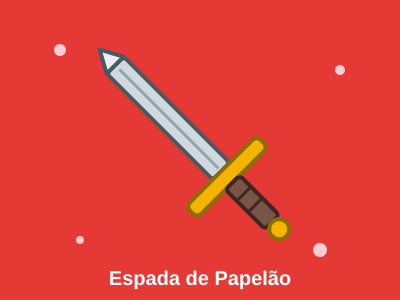
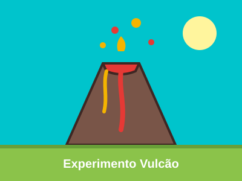

<h1 align="center">🔧 A infância por trás do DIY (Do It Yourself)</h1>

  

  
  
  
  

---

## 🧪 Sobre o projeto

A **confecção** de objetos, quaisquer que sejam, por exemplo: cerâmicas, origamis e ferramentas, é uma forma de **passar o tempo** e desenvolver novas habilidades de maneira agradável e recompensadora. Além disso, essas atividades estimulam a criatividade, a concentração e a capacidade de resolver problemas, permitindo que cada pessoa explore seus interesses e transforme ideias em criações concretas.

A ideia é reunir **experimentos e montagens de objetos feitos à mão**, como:

- ⚔️ **Espadas e armas de brinquedo** (de papelão, EVA, madeira)
- 🚀 **Foguetes, carrinhos e engenhocas** simples
- 🔬 **Experimentos caseiros** com materiais do dia a dia
- 🎭 **Fantasias e acessórios** para brincar e imaginar

Mais do que diversão, essas atividades desenvolvem:

- 💡 **Criatividade**: transformar uma ideia em algo real
- 🎯 **Concentração**: seguir cada etapa da montagem
- 🧩 **Resolução de problemas**: testar, errar e tentar de novo
- 🌱 **Autonomia**: aprender fazendo, com as próprias mãos

---

## 🖼️ Galeria de criações

  
  
  

---

## 🛠️ Tecnologias e Ferramentas

**Desenvolvimento**

  
  
  

**Design e organização**

  
  
  
  
  

---

## 🎓 Sobre o desenvolvimento

Este projeto é desenvolvido com fins acadêmicos.
